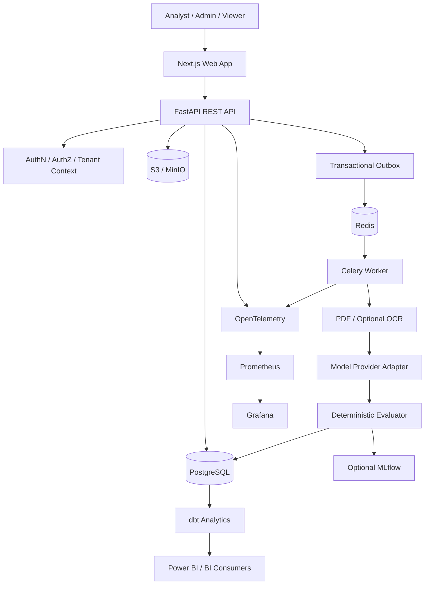

# CareQA — Engineering Handoff

**Product:** Healthcare Document AI Quality & Operations Intelligence Platform  
**Status:** Architecture baseline  
**Default branch:** main  
**Data policy:** Synthetic and public non-sensitive data only.

> CareQA is an independent portfolio product inspired by healthcare document analytics workflows. It must not use former-employer source code, confidential workflows, or patient-identifiable data. It is not a clinical product or a healthcare compliance certification.

## 1. Executive summary

CareQA evaluates the quality and operational performance of AI-assisted healthcare-document extraction and summarisation. It accepts synthetic document cases and reference annotations, runs deterministic and optional AI-assisted evaluations, records reproducible experiment metadata, and exposes quality and operations analytics.

The initial product path is fully automated and does not require a human-in-the-loop to complete a benchmark run. Deterministic evaluation is the source of truth for field-level checks. Optional model-judge signals are stored separately and never represented as clinical truth.

## 2. Goals

- Reproducible document-level and field-level evaluation against versioned reference data.
- Deterministic synthetic-data generator and no-paid-API demo mode.
- Optional pluggable live LLM provider, disabled by default.
- Async batch processing with idempotency and bounded retries.
- Dataset, model, prompt, and evaluator version tracking.
- Quality, reliability, latency, and cost analytics.
- Tenant-aware authorization and auditability.
- Reproducible local environment, automated tests, CI, operations documentation.

Non-goals for the first release: real patient data, clinical diagnosis or treatment recommendations, live claims adjudication, compliance certification, mandatory reviewer workflows, and premature microservices/Kubernetes.

## 3. Users and workflows

| Persona | Need |
|---|---|
| Data / BI analyst | Benchmark quality and operational trends |
| AI quality engineer | Compare model and prompt versions |
| QA / operations lead | Understand defect patterns and failures |
| Platform administrator | Manage workspace, access and configuration |
| Executive viewer | Read aggregate performance indicators |

Primary workflow: seed/import versioned synthetic dataset → validate reference annotations → create run with model/prompt/evaluator versions → process document → generate prediction → evaluate deterministically → persist item results and aggregates → compare compatible runs → report metrics.

## 4. Functional scope

### P0 — first complete vertical slice
- Deterministic synthetic benchmark generator.
- Dataset/case management.
- Offline deterministic model adapter (no API key).
- Structured output validation.
- Field exact/normalized match, completeness, precision, recall and F1 when applicable.
- Run lifecycle, result API and analytical overview.
- Seed-and-evaluate demo command.
- Docker Compose and tests.

### P1 — advanced capabilities
- PDF extraction (PyMuPDF) and optional OCR (Tesseract).
- Optional LLM provider adapter with timeouts, retries, rate limits and schema validation.
- Summary evaluation: deterministic checks plus optional separately labelled LLM-as-judge signals.
- Redis/Celery async workers.
- S3/MinIO artifact storage.
- MLflow experiment tracking.
- dbt analytics models and Power BI-friendly star schema.
- OpenTelemetry, Prometheus and Grafana.

### P2 — hardening
- Multi-tenant RBAC and PostgreSQL RLS.
- Artifact retention/deletion and audit export.
- Drift/anomaly detection.
- Cost attribution and budgets.
- Optional review workflow; never required for automated runs.

## 5. Architecture decision

Use a modular monolith with separately runnable API and worker processes. Keep domain modules independently testable. Avoid microservices until operational scale justifies them.



### Technology choices

| Concern | Technology | Responsibility |
|---|---|---|
| Web | Next.js + TypeScript | Dashboard and workflow UI |
| UI | Tailwind CSS + shadcn/ui | Accessible design system |
| Charts | Recharts | Quality and operations views |
| API | FastAPI + Pydantic v2 | Typed REST contracts |
| Persistence | SQLAlchemy 2 + PostgreSQL | Operational source of truth |
| Migrations | Alembic | Schema evolution |
| Queue | Redis + Celery | Background batch work |
| PDF | PyMuPDF | Text extraction |
| OCR | Tesseract adapter | Optional scanned documents |
| AI | Provider protocol + mock adapter | Provider-independent inference |
| Evaluation | Custom deterministic metrics; optional DeepEval | Grounded scoring |
| Experiments | MLflow | Reproducible experiment tracking |
| Analytics | dbt Core | BI transformations |
| Monitoring | OpenTelemetry, Prometheus, Grafana | Traces and metrics |
| Tests | Pytest, HTTPX, Playwright | Unit, API and E2E |
| Delivery | Docker Compose, GitHub Actions | Reproducibility and CI |

Pin dependency versions and verify compatibility in CI.

## 6. Data model

| Entity | Key fields | Purpose |
|---|---|---|
| Tenant | id, name, status | Workspace boundary |
| User | id, email, password_hash | Identity |
| Membership | tenant_id, user_id, role | Tenant authorization |
| Dataset | id, tenant_id, name, version, schema_json | Benchmark version |
| DatasetCase | id, dataset_id, case_key, document_type, reference_json, source_text | Ground truth |
| Document | id, tenant_id, dataset_case_id, storage_key, sha256, status | Document metadata |
| ModelConfig | id, provider, model_name, config_json, secret_ref | Provider configuration |
| EvaluationRun | id, tenant_id, dataset_id, model_config_id, prompt_version, evaluator_version, status, started_at, completed_at | Reproducible run |
| Prediction | id, run_id, case_id, output_json, latency_ms, token_usage_json, error_code | Model output |
| FieldResult | id, prediction_id, field_path, expected_value, actual_value, outcome | Field-level result |
| SummaryResult | id, prediction_id, metric_name, score, evidence_json, evaluator_kind | Summary quality signal |
| RunMetric | id, run_id, metric_name, metric_value, metric_unit | Aggregates |
| AuditEvent | id, tenant_id, actor_id, action, resource_type, resource_id, created_at | Audit trail |
| OutboxEvent | id, aggregate_type, aggregate_id, event_type, payload_json, published_at | Reliable queue publication |

Use UUID IDs, UTC timestamps, decimal monetary values, JSONB only for flexible payloads, immutable dataset/evaluator versions for completed runs, and secret references rather than stored provider secrets. Enforce tenant scope in service authorization and PostgreSQL RLS where enabled.

## 7. Evaluation methodology

### Deterministic field metrics
- Exact match.
- Normalized match using field-specific normalization while preserving raw values.
- Completeness of required fields.
- Precision, recall and F1 for explicitly matchable entities/sets.
- Schema validity.
- Field-specific numeric tolerance with explicit unit.

Document denominator/null/duplicate handling and micro vs macro aggregation. Do not average percentages blindly.

### Summary evaluation
- Deterministic required-fact coverage.
- Unsupported named-entity and contradictory-value checks.
- Optional model-judge metrics for faithfulness/relevance, clearly labelled probabilistic signals.
- Persist evaluator kind as deterministic, model_judge, or human_adjudication.
- Never blend judge scores and deterministic accuracy into an opaque score.

### Reproducibility
Store dataset version/hash, provider/model, prompt version/hash, generation settings, evaluator version, code version, seed, timestamps, and environment metadata.

## 8. API contract

All endpoints are under `/api/v1`. Use consistent errors, request IDs, pagination and OpenAPI docs.

| Method | Route | Purpose |
|---|---|---|
| GET | `/health/live` | Liveness |
| GET | `/health/ready` | Readiness |
| GET | `/api/v1/overview` | Aggregate KPIs |
| GET/POST | `/api/v1/datasets` | List/create datasets |
| POST | `/api/v1/datasets/{id}/cases` | Add/import cases |
| GET/POST | `/api/v1/documents` | List/ingest documents |
| GET | `/api/v1/documents/{id}` | Document details |
| POST | `/api/v1/runs` | Create evaluation run |
| GET | `/api/v1/runs` | List runs |
| GET | `/api/v1/runs/{id}` | Run status |
| GET | `/api/v1/runs/{id}/results` | Item results |
| GET | `/api/v1/runs/{id}/metrics` | Aggregate metrics |
| GET | `/api/v1/compare?baseline=&candidate=` | Compare compatible runs |
| GET | `/api/v1/audit/events` | Audit history |

Long-running runs return 202 with a run ID. The offline vertical slice may execute synchronously while preserving a worker-ready boundary.

## 9. Security and privacy

- Synthetic/public non-sensitive datasets only.
- No employer code, credentials, confidential workflows or identifiable health data.
- Modern password hashing, explicit token/session expiry.
- Authorization on every resource access; UI hiding is not authorization.
- Tenant-scoped queries and cross-tenant denial tests.
- Upload magic-byte/MIME validation, size/page limits, server-generated storage names.
- Never execute or render active uploaded content.
- Short-lived signed URLs for artifacts.
- Rate limiting on auth/uploads.
- Keep secrets and document contents out of logs/traces.
- Audit security-sensitive actions.
- Retention and deletion for raw and derived artifacts.
- Dependency, secret and container scanning.
- Treat OCR and model outputs as untrusted; escape UI rendering and validate schemas.

**Regulatory boundary:** portfolio demonstration only. No claim of ADHICS, DoH, NABIDH, Riayati or UAE healthcare compliance. Real healthcare deployment requires independent legal, privacy, security and clinical-governance review.

## 10. Reliability and observability

- Bounded retries with exponential backoff and jitter.
- Idempotency key for `(run_id, case_id, attempt/version)`.
- Persist state transitions and failure codes.
- Transactional outbox for DB-to-queue publication.
- Distinguish permanent validation errors and transient failures.
- Provider timeouts, concurrency limits and budgets.
- Stage-level latency and throughput metrics.
- Redact sensitive attributes in telemetry.

## 11. Testing and CI

Backend: metric edge cases, provider contracts, API/database integration, run state/idempotency, authorization and tenant tests.

Frontend: component states, API integration, Playwright flows (seed demo → run → inspect → compare).

Analytics: dbt schema/relationship tests and aggregate reconciliation tests.

Security: upload tests, access controls, dependency/secret scans.

CI gates: formatting/lint, type checks, unit tests, integration tests, frontend build, dependency/secret scan, container build. A check is passed only if it actually runs successfully.

## 12. Repository structure

```text
careqa/
├── apps/web/
├── services/api/
├── analytics/dbt/
├── datasets/synthetic/
├── evaluation/
├── infrastructure/
├── docs/
├── .github/workflows/
├── docker-compose.yml
├── .env.example
├── Makefile
└── README.md
```

The first vertical slice may use a smaller executable layout, but must preserve clear package boundaries and avoid empty placeholder modules.

## 13. Delivery milestones

| Milestone | Deliverable | Exit criteria |
|---|---|---|
| M0 | This handoff | Architecture, data, API, threat model, testing documented |
| M1 | Foundation | Clean startup, health checks, CI |
| M2 | Deterministic vertical slice | Synthetic cases → offline prediction → evaluator → persisted metrics |
| M3 | Product UI | API-backed dashboards and E2E flow |
| M4 | Advanced processing | PDF/OCR, queue, object storage, retries |
| M5 | Analytics / operations | dbt, BI models, MLflow, observability |
| M6 | Release hardening | Security, performance, docs and demo verified |

## 14. Definition of done

- A clean clone starts using documented commands.
- Offline demo requires no API key.
- Synthetic data generation is deterministic.
- Evaluation runs end to end and persists results.
- Known fixtures yield expected metrics.
- Dashboard uses API-backed data, not hardcoded sample values.
- Loading, empty, error and retry states are handled.
- Tests and CI checks pass; results are recorded.
- No secrets or sensitive data are committed.
- Setup, architecture, data, API, testing, deployment and demo docs are current.
- Limitations and unfinished features are disclosed.

## 15. Implementation order

1. Commit this handoff before product code.
2. Implement synthetic generator, offline adapter, deterministic evaluator, persistence and overview API.
3. Add Next.js dashboard against the contract.
4. Add integration and end-to-end tests.
5. Add async queue, PDF/OCR, MLflow, dbt, Power BI exports and observability incrementally.
6. Verify locally and in GitHub Actions before claiming completion.

## 16. Portfolio evidence

Only report measured results: synthetic document/field counts, exact and normalized accuracy with metric definitions, injected defect detection, throughput/latency under documented conditions, model comparisons on identical datasets, test/CI status, and implemented security controls. Never turn target thresholds or hypothetical numbers into achievements.
