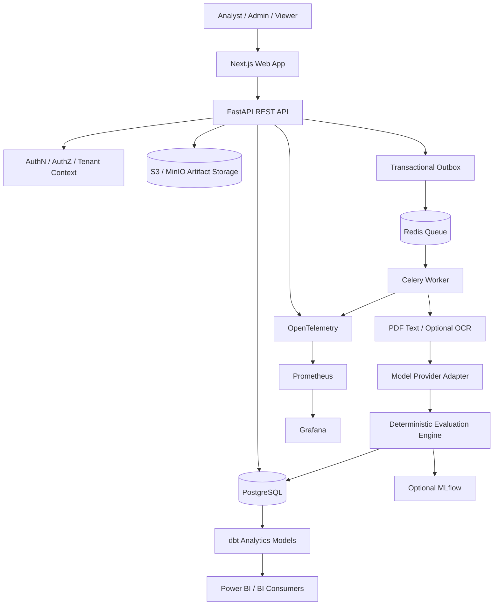

# CareQA — Engineering Handoff

**Product:** Healthcare Document AI Quality & Operations Intelligence Platform  
**Status:** Approved architecture / implementation baseline  
**Repository:** `wazimBadSha/CareQA-Healthcare-Document-AI-Quality-Operations-Intelligence-Platform.`  
**Default branch:** `main`  
**Data policy:** Synthetic and public non-sensitive data only. No employer-owned, patient-identifiable, or confidential datasets.

> CareQA is an independent portfolio product inspired by healthcare document analytics workflows. It is not affiliated with or derived from any former employer's proprietary systems. It is not a medical device, clinical decision-support product, or certified healthcare compliance platform.

## 1. Executive summary

CareQA evaluates the quality and operational performance of AI-assisted healthcare-document extraction and summarisation. It accepts synthetic document cases and reference annotations, runs deterministic and optional AI-assisted evaluations, records reproducible experiment metadata, and exposes quality and operations analytics.

The product's core value is **evidence-based AI quality measurement**, not a dashboard alone. Evaluation separates deterministic checks, model-judge signals, and optional human adjudication. This repository's initial product mode has **no human-in-the-loop dependency**: ingestion, evaluation, scoring, reporting, and benchmark comparison operate automatically. Human review may be added later as an optional workflow, but is not required for the end-to-end product path.

## 2. Goals and non-goals

### Goals
- Reproducible document-level and field-level evaluation against versioned reference data.
- Automated synthetic-data generation and a no-paid-API demo path.
- Optional pluggable live LLM provider, disabled by default.
- Reliable asynchronous processing for document batches.
- Model/prompt/dataset/evaluator version metadata.
- Quality, reliability, latency, and cost analytics.
- Tenant-aware authorization and auditability from the outset.
- Local one-command development with Docker Compose.
- Automated tests, linting, CI, operational documentation, and reproducible demo.

### Non-goals for the first release
- Real patient data or production clinical deployment.
- Clinical diagnosis, treatment recommendations, or claims adjudication decisions.
- Certification or assertion of compliance with UAE healthcare regulations.
- Autonomous use of model-judge scores as clinical truth.
- Kubernetes or microservices before demonstrated operational need.
- Mandatory human review to complete a benchmark run.

## 3. Target users and workflows

| Persona | Primary need | Main workflow |
|---|---|---|
| Data / BI analyst | Understand quality and operational trends | Select benchmark → run → analyse dashboard |
| AI quality engineer | Compare model/prompt versions | Configure run → execute → compare metrics |
| QA / operations lead | Understand failure patterns | Inspect defect aggregates and run diagnostics |
| Platform administrator | Manage workspace and configuration | Manage users, tenants and provider settings |
| Executive viewer | Understand risk and performance | Read aggregate scorecards and trends |

### Primary automated workflow
1. Seed or import a versioned synthetic benchmark dataset.
2. Validate dataset schema and reference annotations.
3. Create a run with dataset, model adapter, prompt version, and evaluator version.
4. Enqueue processing through a durable job mechanism.
5. Parse source text, generate deterministic/mock or optional provider output.
6. Validate structured output and compare it with ground truth.
7. Calculate metrics, persist item-level results and aggregate scores.
8. Publish run completion and refresh analytics projections.
9. Compare runs on the same benchmark and report quality/latency/cost deltas.

## 4. Product capabilities

### P0 — first releasable vertical slice
- Synthetic benchmark generator with deterministic seed.
- Dataset and case management.
- Document metadata and extracted-text storage.
- Offline deterministic model adapter (no API key required).
- Schema validation and field-level scoring.
- Completeness, exact match, normalized match, precision, recall, and F1 where applicable.
- Run lifecycle and item-level result APIs.
- Dashboard: run counts, field accuracy, completeness, defect counts, latency.
- CLI/seed command that generates and evaluates a demo benchmark.
- Docker Compose and automated tests.

### P1 — advanced portfolio capabilities
- PDF text extraction using PyMuPDF; OCR adapter using Tesseract as an optional dependency.
- Provider adapter interface for live LLMs with timeout, retries, rate limits, and structured-output validation.
- Summary evaluation: deterministic checks plus optional LLM-as-judge signals, explicitly labelled non-ground-truth.
- MLflow experiment tracking.
- Redis/Celery asynchronous workers and idempotent task handling.
- MinIO/S3 object storage for uploaded artifacts.
- dbt analytics models and Power BI-friendly star schema.
- OpenTelemetry traces/metrics, Prometheus and Grafana.

### P2 — hardening and extension
- Multi-tenant RBAC and PostgreSQL row-level security.
- Signed URL handling and malware scanning integration point.
- Data retention/deletion workflows and audit export.
- Drift and anomaly detection on evaluation outcomes.
- Model cost attribution and budget controls.
- Optional reviewer workflow (never required for automated execution).

## 5. Architecture decision

Use a **modular monolith** with separately runnable API and worker processes. Domain modules remain independently testable. This avoids unnecessary distributed-system complexity while permitting asynchronous processing and later extraction of services where justified.

### Logical architecture



### Runtime components
- **Web:** Next.js + TypeScript; accessible component system; charts; typed API client.
- **API:** FastAPI, Pydantic v2, SQLAlchemy 2, Alembic.
- **Database:** PostgreSQL as operational source of truth.
- **Queue:** Redis + Celery for batch evaluation jobs (P1); synchronous background-free demo path remains available for local CI.
- **Artifacts:** local filesystem adapter in tests; MinIO/S3 adapter in deployed environments.
- **Evaluation:** pure Python domain package with deterministic metric implementations.
- **Analytics:** SQL/dbt transformations over persisted run and item results.
- **Observability:** OpenTelemetry instrumentation; Prometheus/Grafana optional in local compose profile.

## 6. Technology choices and rationale

| Concern | Choice | Rationale |
|---|---|---|
| Frontend | Next.js + TypeScript | Typed, accessible, maintainable web UI |
| UI | Tailwind CSS + shadcn/ui | Reusable components and consistent design |
| Charts | Recharts | React-native charts for analytics |
| API | FastAPI + Pydantic v2 | Typed contracts, validation, OpenAPI |
| Persistence | SQLAlchemy 2 + PostgreSQL | Explicit transactions and durable relational model |
| Migrations | Alembic | Version-controlled schema changes |
| Queue | Redis + Celery | Background batch jobs, retries, task lifecycle |
| Document parsing | PyMuPDF | PDF text extraction |
| OCR | Tesseract adapter | Optional scanned-document support |
| AI providers | Provider protocol + mock adapter | Deterministic baseline and provider independence |
| Evaluation | Custom deterministic metrics; optional DeepEval | Grounded checks first; model-judge signals separated |
| Experiments | MLflow (P1) | Run parameters, metrics, artifacts |
| Analytics | dbt Core (P1) | Tested analytical transformations |
| BI | Power BI-compatible warehouse views | Recruiter-relevant BI artifact |
| Observability | OpenTelemetry, Prometheus, Grafana | Vendor-neutral traces and metrics |
| Tests | Pytest, HTTPX, Playwright | Unit, API and end-to-end coverage |
| Delivery | Docker Compose, GitHub Actions | Reproducible environment and CI |

Versions must be pinned and refreshed deliberately during implementation; do not invent compatibility assumptions. Dependabot/Renovate can be added after the first dependency lock is established.

## 7. Data model

The canonical logical entities are:

| Entity | Key fields | Purpose |
|---|---|---|
| Tenant | id, name, status, created_at | Workspace boundary |
| User | id, email, password_hash, is_active | Authentication identity |
| Membership | tenant_id, user_id, role | Tenant-scoped authorization |
| Dataset | id, tenant_id, name, version, schema_json | Benchmark version |
| DatasetCase | id, dataset_id, case_key, document_type, reference_json, source_text | Ground-truth case |
| Document | id, tenant_id, dataset_case_id, storage_key, sha256, status | Document metadata |
| ModelConfig | id, provider, model_name, config_json, secret_ref | Non-secret provider configuration |
| EvaluationRun | id, tenant_id, dataset_id, model_config_id, prompt_version, evaluator_version, status, started_at, completed_at | Reproducible run |
| Prediction | id, run_id, case_id, output_json, summary_text, latency_ms, token_usage_json, error_code | Model result |
| FieldResult | id, prediction_id, field_path, expected_value, actual_value, outcome, metric_json | Field-level result |
| SummaryResult | id, prediction_id, metric_name, score, evidence_json, evaluator_kind | Summary quality signal |
| RunMetric | id, run_id, metric_name, metric_value, metric_unit | Aggregated metric |
| AuditEvent | id, tenant_id, actor_id, action, resource_type, resource_id, metadata_json, created_at | Audit trail |
| OutboxEvent | id, aggregate_type, aggregate_id, event_type, payload_json, published_at | Reliable task publication |

### Data principles
- UUID primary keys for externally referenced entities.
- UTC timestamps stored consistently.
- Monetary values use decimal types with explicit currency.
- JSONB is for flexible payloads, not a replacement for relational constraints.
- Dataset and evaluator versions are immutable once referenced by a completed run.
- Store hashes and provenance for datasets/artifacts.
- Never store provider secrets in `ModelConfig.config_json`; use secret references/environment secret injection.
- Tenant scope is enforced in service authorization and, when multi-tenancy is enabled, PostgreSQL RLS.

## 8. Evaluation methodology

### Deterministic field-level metrics
- **Exact match:** canonical value equals expected value.
- **Normalized match:** comparison after field-specific normalization (whitespace, case, date, currency formatting); preserve original values.
- **Completeness:** non-empty required fields / total required fields.
- **Precision / recall / F1:** for extracted entities or set-valued fields with explicit matching rules.
- **Schema validity:** structured output passes the declared schema.
- **Numeric tolerance:** configured per field and unit; never use a universal tolerance.

Metric definitions, denominator behavior, null handling and aggregation rules must be documented and covered by edge-case tests. Do not average per-case percentages blindly where micro/macro aggregation differs.

### Summary evaluation
- Deterministic checks: required fact coverage, unsupported named entities, source phrase alignment where possible, contradictory values against reference facts.
- Optional judge metrics: faithfulness/relevance/hallucination heuristics using a pinned evaluator configuration.
- Persist `evaluator_kind` as `deterministic`, `model_judge`, or `human_adjudication`.
- Never combine judge scores with deterministic accuracy into a single opaque score.
- Model-judge outputs are probabilistic signals, not ground truth. Do not describe them as clinical validation.

### Reproducibility metadata
Every run stores dataset version/hash, model provider/model, prompt version/hash, generation parameters, evaluator version, code version, start/end times, random seed where applicable, and environment metadata.

## 9. API contract

All APIs are versioned under `/api/v1`. Use consistent JSON error envelopes, request IDs, pagination and OpenAPI descriptions.

| Method | Route | Description |
|---|---|---|
| GET | `/health/live` | Process liveness |
| GET | `/health/ready` | Dependency readiness |
| GET | `/api/v1/overview` | Aggregate KPI overview |
| GET | `/api/v1/datasets` | List datasets |
| POST | `/api/v1/datasets` | Create dataset |
| POST | `/api/v1/datasets/{id}/cases` | Add/import cases |
| GET | `/api/v1/documents` | List/search documents |
| POST | `/api/v1/documents` | Upload/ingest document |
| GET | `/api/v1/documents/{id}` | Document details |
| POST | `/api/v1/runs` | Create evaluation run; 202 if asynchronous |
| GET | `/api/v1/runs` | List runs |
| GET | `/api/v1/runs/{id}` | Run status and metadata |
| GET | `/api/v1/runs/{id}/results` | Item-level results |
| GET | `/api/v1/runs/{id}/metrics` | Aggregate metrics |
| GET | `/api/v1/compare?baseline=&candidate=` | Compare compatible runs |
| GET | `/api/v1/audit/events` | Tenant-scoped audit trail |

A run must reject incompatible dataset/evaluator inputs. Long-running jobs return `202 Accepted` with a run ID and status resource. Initial implementation may execute the offline demo run synchronously while preserving a worker-ready application boundary.

## 10. Security, privacy and safety

- Synthetic or approved public non-sensitive data only.
- No real patient records, employer data, credentials, or confidential documents in Git.
- Passwords use a modern password hash; sessions/tokens have explicit expiry and rotation.
- Authorization is checked on every resource access; frontend hiding is not authorization.
- Use tenant-scoped queries and test cross-tenant denial.
- Validate upload MIME type and magic bytes; enforce file/page/size limits; generate storage names server-side.
- Do not render uploaded HTML or execute embedded document content.
- Use signed, short-lived artifact URLs where applicable.
- Rate-limit authentication and upload operations.
- Keep secrets out of source, logs, traces, exceptions and analytics.
- Audit security-sensitive actions without logging document contents or PII.
- Apply retention and deletion policies to uploaded artifacts and derived data.
- Add dependency, secret, and container scanning in CI.
- Treat OCR output and LLM output as untrusted input; escape rendered text and validate structured output.

**Regulatory boundary:** The system is a portfolio demonstration, not a healthcare production deployment or compliance certification. UAE federal and emirate-specific health-data requirements must be reviewed by qualified counsel and relevant authorities before any real health data or production use. Do not claim ADHICS, DoH, NABIDH, Riayati, or other regulatory compliance without a formal assessment and evidence.

## 11. Reliability and operations

- Use bounded retries with exponential backoff and jitter for transient provider/queue errors.
- Make task processing idempotent with a unique `(run_id, case_id, attempt/version)` key.
- Persist run state transitions and failure reason codes.
- Use transactional outbox for database-to-queue publication in the asynchronous release.
- Distinguish permanent validation failures from transient infrastructure failures.
- Add timeouts and concurrency limits to provider calls.
- Capture latency by pipeline stage; redact sensitive attributes from telemetry.
- Define retention for task results, raw documents, and evaluation artifacts.

## 12. Testing and quality gates

### Backend
- Metric unit tests including empty values, nulls, numeric tolerance, date normalization and duplicate entities.
- Provider adapter contract tests.
- API integration tests with a disposable PostgreSQL database.
- Run state-transition and idempotency tests.
- Authorization and tenant-isolation tests.

### Frontend
- Component tests for loading, empty, error and populated states.
- API contract integration tests.
- Playwright flows: seed demo → run evaluation → inspect metrics → compare runs.

### Data / analytics
- dbt schema and relationship tests.
- Reconciliation tests between source results and aggregate metrics.
- Metric definition fixtures with known expected values.

### Security
- Dependency and secret scanning.
- Upload validation tests.
- Access-control tests.
- No secrets or private dataset fixtures in repository.

### CI gates
1. Format/lint.
2. Type checking.
3. Unit tests.
4. Integration tests.
5. Frontend build.
6. Dependency and secret scanning.
7. Container build (when configured).

Do not report a gate as passed unless it actually ran and returned success.

## 13. Repository layout

```text
careqa/
├── apps/web/                 # Next.js dashboard
├── services/api/             # FastAPI application and domain modules
├── analytics/dbt/            # dbt project and tests
├── datasets/synthetic/       # Generated, non-sensitive fixtures
├── evaluation/               # Benchmark definitions and evaluator configs
├── infrastructure/           # Docker, monitoring and deployment
├── docs/                     # Architecture, contracts and operations
├── .github/workflows/        # CI workflows
├── docker-compose.yml
├── .env.example
├── Makefile
└── README.md
```

The first implementation may simplify this structure to keep the executable vertical slice small, but must preserve clear package boundaries and avoid empty placeholder modules.

## 14. Delivery milestones

| Milestone | Deliverable | Exit criteria |
|---|---|---|
| M0 — Handoff | PRD, architecture, data model, API, threat model, test strategy | Reviewed docs committed before implementation |
| M1 — Foundation | API skeleton, database migrations, frontend shell, local compose | Clean startup, health checks and CI |
| M2 — Deterministic vertical slice | Synthetic generator, dataset cases, offline adapter, evaluation engine | Reproducible metrics with tests |
| M3 — Product UI | Dashboard, documents, run history, results and comparison | Playwright end-to-end path passes |
| M4 — Advanced processing | PDF/OCR adapters, Celery, Redis, object storage | Batch run, retries and idempotency verified |
| M5 — Analytics / operations | dbt, BI-ready models, MLflow, observability | Reconciled reporting and traces |
| M6 — Release hardening | Security, performance, docs, demo assets | All declared gates pass; limitations documented |

## 15. Definition of done

A release is complete only when:
- A clean clone can be configured using documented commands.
- No API key is required for the offline demo.
- Synthetic data can be generated deterministically.
- An evaluation run can be executed end to end.
- Known test fixtures produce expected metric values.
- Run results and metadata persist in PostgreSQL.
- Dashboard screens show real API-backed data, not hardcoded sample values.
- Errors, empty states, loading states and retries are handled.
- Tests and CI checks pass and their results are recorded.
- No secrets or sensitive data are committed.
- Setup, architecture, data model, API, testing, deployment and demo docs are current.
- Project limitations and unimplemented features are clearly identified.

## 16. Initial execution order

1. Commit this handoff before product code.
2. Inspect and implement the smallest complete vertical slice: synthetic cases → offline prediction adapter → deterministic evaluator → persisted run/results → overview API.
3. Add the Next.js dashboard against the API contract.
4. Add integration and end-to-end tests.
5. Add async queue, PDF/OCR, MLflow, dbt, Power BI exports and observability incrementally.
6. Verify locally and through GitHub Actions before describing the repository as complete.

## 17. Portfolio evidence to collect

Only report measured implementation results. Record:
- Number of synthetic documents and fields evaluated.
- Exact/normalized field accuracy and completeness, with metric definitions.
- Number and types of injected defects detected.
- Processing throughput and latency under a documented test environment.
- Model comparison results on an identical dataset version.
- Test coverage and CI status.
- Architecture decisions and security controls actually implemented.

Never convert target thresholds or example numbers into claimed achievements.