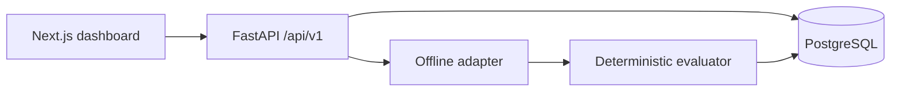

# Architecture

CareQA is a modular monolith with a separately deployable Next.js dashboard and FastAPI service. The initial execution mode is synchronous so an offline benchmark can run in CI and on a laptop without Redis, an LLM key, or external artifacts.

## Implemented boundaries

- The API resolves a tenant from `X-Tenant-Id` and scopes every persisted dataset, document, run, and audit query to it. The seeded development tenant is `demo`.
- SQLAlchemy models store immutable benchmark provenance (`content_hash`, version), run reproducibility metadata (prompt hash, evaluator version, seed, environment), predictions, field outcomes, aggregates, documents, and audit metadata.
- The run application service owns lifecycle transitions and transaction boundaries; swapping its direct call for an idempotent queue worker does not change the HTTP contract.
- `OfflineAdapter` never calls a provider. Its controlled defects are stable for `(seed, case_key)` and make the evaluation visible in the UI.

## Deliberately deferred

Celery/Redis/outbox, PDF/OCR, object storage, authenticated identities/RBAC/RLS, live LLM provider adapters, summary judge signals, dbt, MLflow and production telemetry are not implemented. They must not be represented as available features or compliance controls.
